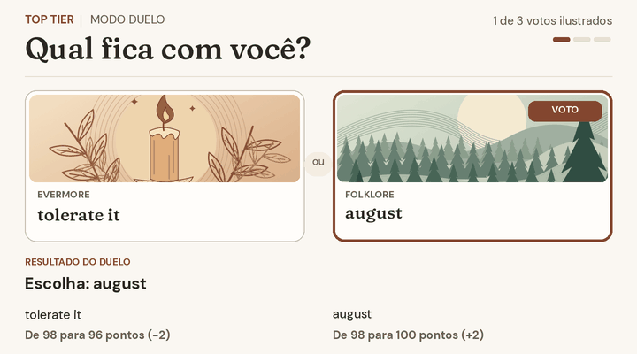

# Top Tier

[![CI][ci-badge]][ci] · [Português](#português) · [English](#english)

## Português

Explore 49 músicas de **evermore** e **folklore** (edições deluxe) e **reputation** (edição
original). Compare a curadoria editorial com suas notas, escolha entre duas faixas no Duelo ou
organize seu próprio quadro de tiers. A ficha de cada faixa traz a justificativa da nota, o contexto
musical e um link que busca o título, a artista e o álbum no YouTube Music.

A [demo no GitHub Pages][demo] fica disponível após habilitar **Settings → Pages → GitHub Actions**
e concluir o primeiro deploy da versão na `main`. O estado do workflow aparece no badge de CI.

### Rodar e testar

Use Node.js **22.12 ou superior**. Na pasta que contém `package.json`, execute os comandos abaixo.
`npm ci` instala as versões do lockfile. Para atualizar dependências, use `npm install`.

```sh
npm ci
npm run dev
```

Abra o endereço que o Vite mostrar no terminal. Para verificar o projeto e servir o build estático,
rode os comandos a seguir. A pasta de saída é `dist/`.

```sh
npm run lint
npm run typecheck
npm test
npm run build
npm run preview
```

`npm run test:watch` acompanha alterações. `npm run test:coverage` mede a cobertura. Após o build,
`npm run check:size` mede o JavaScript inicial comprimido e `npm run check-contrast` verifica as
combinações de cor. Para testar o fluxo completo em Chromium, execute
`npx playwright install chromium` e `npm run test:e2e`. `npm run lighthouse` audita o build com
Chrome/Chromium instalado. `npm run format` aplica o Prettier.

### Montar e compartilhar um ranking

- **Por álbum e geral.** Busque por título, filtre por álbum, tier, nota mínima ou favoritos e
  escolha a ordenação. A posição exibida continua sendo a posição na lista completa.
- **Duelo.** Escolha a faixa da esquerda com `←`, a da direita com `→`, empate com `↓` ou pule com
  `S`. Os atalhos podem ser desativados. **Aplicar ao Meu ranking** grava as notas das faixas que
  você comparou. No exemplo ilustrado abaixo, escolher _august_ sobre _tolerate it_ leva suas notas
  de 98 e 98 para 100 e 96.
- **Quadro de tiers.** Arraste a faixa até uma linha ou use o formulário de música e tier. Com o
  teclado, use espaço para pegar, as setas para selecionar o destino, espaço para soltar e `Esc`
  para cancelar. A faixa recebe a nota central da faixa de pontos do tier escolhido.
- **Compartilhamento.** Copie o link para abrir o ranking em modo de leitura, exporte ou importe as
  notas em JSON e salve o cartão de 1080 × 1350 px com o top 5. A comparação mostra mudanças de
  posição e o coeficiente de Kendall (τ). Ele vale +1 para duas ordens idênticas e −1 para ordens
  inversas.



Cada música começa com oito vezes sua nota editorial em pontos Elo. Uma vitória inesperada move mais
pontos que uma vitória prevista. Cada faixa usa `K = 32` nas primeiras dez comparações e `K = 16`
nas seguintes. Empates valem meio ponto e pular avança o par. O pareamento evita repetições recentes
e prioriza músicas com poucas comparações e pontuações próximas. A barra de confiança mede a
cobertura das comparações, limitada a dez por faixa. Ao aplicar, o sistema divide o Elo por oito,
arredonda e limita o resultado ao intervalo de 0 a 100.

### Editar o catálogo

1. Edite `songSeeds` em `src/data/songs.ts`. Informe álbum, número da faixa na edição, título, nota
   inteira de 0 a 100, `justificativa` e `contexto`. Atualize as traduções em `translations.ts`.
2. Para incluir um álbum, acrescente o ID em `types.ts`, os metadados e `ordemReferencia` em
   `albums.ts`, o emblema em `public/images/` e a fonte da tracklist em `sources.ts`.
3. A aplicação deriva tier e posições da nota. O campo `id` usa o álbum e o número original da
   faixa. Preserve esses valores ao editar uma música existente para manter notas e favoritos já
   salvos. O ID de _champagne problems_, por exemplo, é `evermore-02`.
4. `src/data/tiers.ts` define todas as faixas de pontos em `TIER_SCALE`. O ranking editorial
   desempata pela ordem dos álbuns e pelo número da faixa. O pessoal desempata pela posição
   editorial. Após ampliar o catálogo, revise os testes de integridade das edições e rode
   `npm test`.

Os dados pessoais ficam no navegador. O carregamento da versão 2 recupera as notas e os favoritos da
versão 1 no mesmo endereço. Para levar notas a outro navegador ou endereço, exporte o JSON.

## English

Explore 49 songs from the deluxe editions of **evermore** and **folklore** and the original edition
of **reputation**. Each track has an editorial score, commentary, album and overall positions, and a
YouTube Music search link. Build a personal ranking by rating songs, comparing pairs or moving
tracks on the tier board.

The [GitHub Pages demo][demo] becomes available after Pages uses **GitHub Actions** as its source
and the first deployment from `main` succeeds. See the [CI workflow][ci] for its current status.

### Run locally

From the repository root, use Node.js **22.12 or later** and run `npm ci` followed by `npm run dev`.
Open the URL printed by Vite. Run `npm run lint`, `npm run typecheck`, `npm test` and
`npm run build` to validate the source and generate `dist/`. Run `npm run preview` to serve that
build locally.

For coverage, use `npm run test:coverage`. For a browser test, build the app, install Chromium with
`npx playwright install chromium`, then run `npm run test:e2e`. `npm run check-contrast`,
`npm run check:size` and `npm run lighthouse` check color contrast, initial JavaScript size and
mobile Lighthouse performance. The default base path is `/`. Set `VITE_BASE_PATH=/Top-tier/` for a
build hosted in this repository’s Pages subdirectory.

### Use and edit the collection

- Search, filter or sort the complete catalog. Open a song to read its score rationale or search for
  the recording on YouTube Music. Album insights compare editorial and personal averages, count
  songs in each tier and identify the largest difference between the two sets of scores.
- In Duel, use `←` or `→` to vote, `↓` for a draw, and `S` to skip. The starting Elo rating is eight
  times the editorial score. Each track uses `K = 32` for its first ten rated comparisons and
  `K = 16` afterward. The next pair favors undercompared tracks with similar ratings and avoids
  recently seen pairs. The confidence bar measures coverage up to ten comparisons per song. Applying
  divides each compared track’s rating by eight, rounds it and clamps it to 0–100.
- On the tier board, use drag and drop or choose a track and destination in the form. Space picks up
  and drops, arrow keys select the tier, and `Esc` cancels. A move sets the score to the tier’s
  midpoint. Share a read-only link, export or import score JSON, or download a top-five image.
- Edit `songSeeds` in `src/data/songs.ts` to change a score, track title or Portuguese commentary.
  Update the matching English copy in `src/data/translations.ts`. To add an album, update the
  `AlbumId` type, album metadata, emblem and catalog sources. Keep the original album and track
  number stable when editing. They form the persistent ID used by favorites and personal scores.
- `TIER_SCALE` in `src/data/tiers.ts` defines labels, boundaries and classification. Positions are
  computed before filtering. Editorial ties follow collection order and original track number.
  Personal ties follow editorial position. Run the catalog tests whenever changing release scope.

The application keeps preferences in browser storage and migrates existing scores and favorites on
that origin. Export score JSON to move between browsers or domains.

### Arquitetura / Architecture

| Caminho / Path    | Responsabilidade / Responsibility                                  |
| ----------------- | ------------------------------------------------------------------ |
| `src/app/`        | Rotas e contexto de estado / Hash routes, reducer and context      |
| `src/features/`   | Coleção, ranking, Duelo, tiers, compartilhamento / Feature modules |
| `src/components/` | Diálogo, navegação e avisos / Shared controls and feedback         |
| `src/hooks/`      | Persistência, tema e movimento / Storage, theme and motion hooks   |
| `src/data/`       | Álbuns, faixas, tiers e traduções / Catalog and editorial copy     |
| `src/lib/`        | Ranking, persistência e Kendall τ / Pure rules and storage parsing |
| `src/i18n/`       | Textos da interface em português e inglês / Typed UI dictionaries  |
| `src/styles/`     | Tokens e componentes visuais / Shared design tokens and CSS        |
| `public/`         | Emblemas e ícones originais / Original era art and app icons       |
| `e2e/`            | Fluxo de Duelo e compartilhamento / Playwright user journey        |
| `scripts/`        | Verificações e recursos / Build checks and art generation          |

React and TypeScript render the views. Pure ranking functions keep each position stable when the
visible tracks change. Hash routes work on a static host. The production service worker caches the
app for offline use after its first successful load. The language selector switches the interface
and editorial commentary between Portuguese and English.

**Autor / Author** · Crizan Belem Ribeiro. Projeto independente de fã, sem afiliação. Independent,
unaffiliated fan project. A licença MIT abrange o código. The MIT license covers the code.
[Licença / License](LICENSE) · [Créditos e fontes / Data sources](CREDITS.md) ·
[Changelog](CHANGELOG.md)

[ci-badge]: https://github.com/belemcrizan/Top-tier/actions/workflows/ci.yml/badge.svg
[ci]: https://github.com/belemcrizan/Top-tier/actions/workflows/ci.yml
[demo]: https://belemcrizan.github.io/Top-tier/
